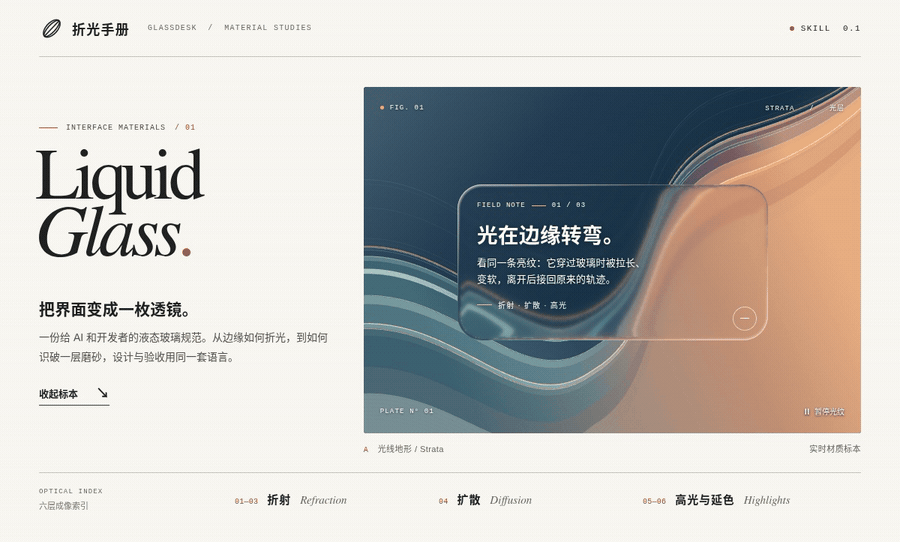
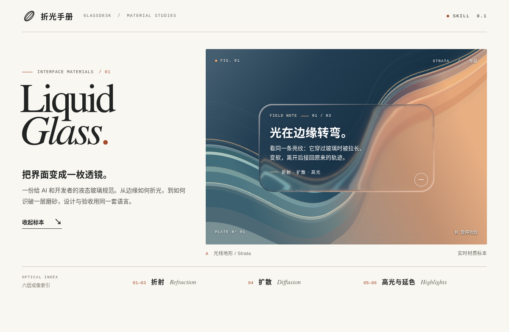

# LiquidGlass Skill 0.1 · 折光手册

GlassDesk 的液态玻璃设计与验收 Skill。**0.1** 是首个对外版本（npm 包版本 **0.1.0**），沿用内部 V7.21 的光学规范。它教 AI 和开发者做一枚二维透镜：同一条背景亮纹到了边缘要拐弯，进入玻璃后可以变软，离开时还能接回去。文字在玻璃上方独立绘制，不跟着背景变形。



[打开交互网页](web/index.html) · [高清动画 MP4](media/specimen.mp4) · [手机截图](media/mobile.png) · [阅读 Skill](liquid-glass/SKILL.md)

## 下载与安装

**一行装进 Codex：** 下载 [liquidglass-skill-0.1.0.tgz](liquidglass-skill-0.1.0.tgz)，不用解包，把它放到项目目录。用 Node.js 22+ 和 npm 10+，在该目录运行：

```bash
npm exec --offline --yes --package=./liquidglass-skill-0.1.0.tgz -- liquidglass-skill install
```

装完后新开 Codex 会话，在提示词里写 `$liquid-glass`。默认只安装到当前项目的 `.agents/skills/liquid-glass/`；希望同一个用户的所有项目都能用，在命令末尾加 `--user`。已有版本不会被覆盖。如要升级，先把旧目录移出 `skills` 保存，再运行新包的安装命令。[Codex Skills 文档](https://learn.chatgpt.com/docs/build-skills) · [npm exec 文档](https://docs.npmjs.com/cli/v11/commands/npm-exec/)

**不用 npm：** 解压完整项目包，把整个 `liquid-glass/` 放进项目的 `.agents/skills/`，最终路径是 `.agents/skills/liquid-glass/SKILL.md`。只想看动画，不必安装 Skill，双击 [离线网页](直接打开-折光手册.html)。

**直接联网下载：** 0.1.0 还未发布到公共 npm 仓库。目前请用上面的本地包，不要按同名包搜索安装。发布到你的 npm 命名空间后，在线安装格式是 `npx --yes @你的命名空间/liquidglass-skill@0.1.0 install`，其中命名空间要换成实际发布的名称。

## 先看一根亮纹

右侧是原创的蓝铜色光纹「光层」。看面板左下角：从外面进来的细亮纹被拉宽，沿圆角偏折；面板上的字却始终锋利。点玻璃右下角的 **−** 收起，再点胶囊翻到下一张。同一块玻璃在原位置变形，没有换成另一张卡片。动画途中可以反向点；「暂停光纹」能单独停住背景，方便盯住一条边。



**离线运行：** 解压完整文件夹，用支持 WebGL 2 的浏览器打开 `web/index.html`。无需安装、服务端或网络。网页保留系统的减少动态效果设置；无法初始化 WebGL 2 时会明确标出「静态可读模式」，它不是液态玻璃验收样例。

## 给 AI 的用法

保留整个 [`liquid-glass/`](liquid-glass/SKILL.md) 文件夹，把 `SKILL.md` 作为入口。不要只复制首页效果图，也不要把这个网页的圆角或滤波半径当成跨平台标准。可以从这句开始：

> 用这份 Liquid Glass Skill 做一个可展开的控件。先指出背景里哪条结构会穿过它、哪段应该折弯。前景文字独立绘制。按同帧同轮廓输出从原图到全开的对照，给出清晰度实测值和未通过项，不要拿动图代替验收。

| 从哪里判断 | 应当看见什么 |
| --- | --- |
| **L1–L3 · 折射** | 临近轮廓的背景沿法线被拉长，在玻璃正面向两端展开，外沿另有渐细的延展。圆角也是边。 |
| **L4 · 扩散** | 先软化已经折射的细节，再让亮处扩散。主结构不能糊掉，前景字不能一起糊。 |
| **L5 · 高光** | 上左与下右有宽肩、亮核，另外两角收成弱丝光。即使关掉 L6，高光也要带一点附近的光色，不是等宽白线。 |
| **L6 · 延色** | 只有折射光真正碰到高光，颜色才从接触段沿高光向两侧延开；不能染整张面。 |

胶囊与面板共用同一材质规则。随着尺寸变化，影响范围可以变，不能从黑玻璃切换成白磨砂。[完整规范](liquid-glass/SKILL.md) 与 [验收协议](liquid-glass/references/acceptance.md) 分开维护。

## 为什么它不只是磨砂

这版不是指定一个万能的「模糊几像素」，而是测**还透过了多少结构**。在这张网页展开态的同一帧，用同一批位置取样，线性亮度结果如下：

| 检查项 | Skill 门槛 | 此网页 |
| --- | ---: | ---: |
| 只加普通模糊后，细纹对比还剩多少 | 40%–85% | **48.1%** |
| 只加普通模糊后，主结构对比还剩多少 | ≥75% | **100.0%** |
| 六层全开后，主结构对比还剩多少 | ≥60% | **97.1%** |
| 同一条边相对无玻璃的位置 | 同向，保留至少一半偏移量 | 只折射 **−11.0 px**；全开 **−11.0 px**（约 ±1 px） |

百分比都以**已折射、尚未模糊**的画面为基线。「100%」是主条纹稳定区域的两组亮度差，不表示它的边没有变软。这是本项目的验收线，不是 Apple 公布的参数。[清晰度标准](liquid-glass/references/04-clarity-gate.md) · [实景四阶段对照](qa/stages.png) · [采样坐标、原帧和复验方法](qa/README.md)

## 动画参考

Apple 在 WWDC25 的 [Dynamics（1:29 起）](https://developer.apple.com/videos/play/wwdc2025/219/?time=89) 展示同一片浮层怎样原地变形成菜单；[Adaptivity（6:00 起）](https://developer.apple.com/videos/play/wwdc2025/219/?time=360) 说明尺寸变化怎样影响材质；[Principles（10:31 起）](https://developer.apple.com/videos/play/wwdc2025/219/?time=631) 讨论形状、光与内容的关系。本页借用这三条设计思路：玻璃缩放时重算轮廓，取样范围随之变化，下一张说明在展开后显现。背景图形、页面、弹簧参数与六层实现均为项目自己的设计，没有使用 Apple 的源码、录屏或字体文件。

**验证边界：** 已在离线 Chromium 检查 WebGL 2 网页、390 px 手机视口、鼠标与键盘操作、中途反向和减少动态效果。GIF、MP4 都从这一个网页逐帧截图，使用同一点击处理与弹簧更新，不是实机帧率录像。这里没有认证 Safari、手机真机、Windows 原生窗口或 PowerPoint，也没有用一张实景合成图替代 L5/L6 的全部专用反例。

## 许可证

项目原创源码和文档采用 [MIT License](LICENSE)。与 Apple 无隶属关系，引用的第三方资料不在本项目授权范围内。
